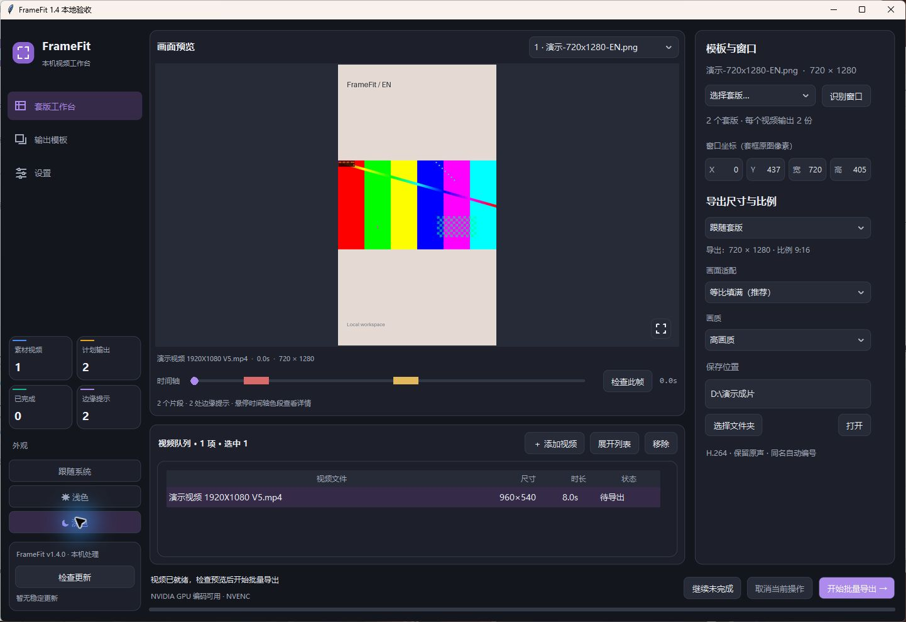
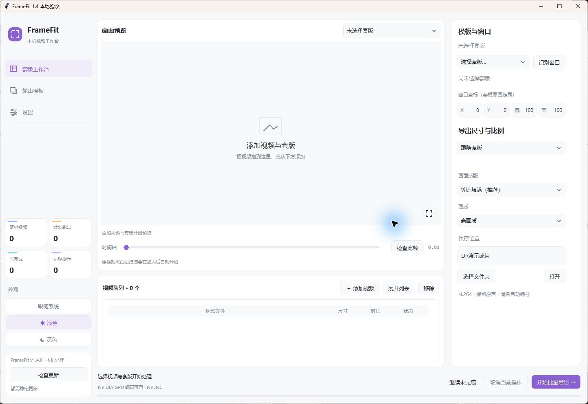
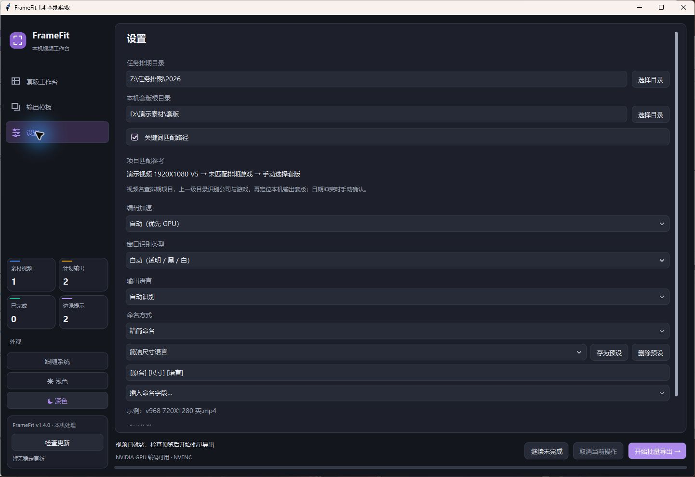
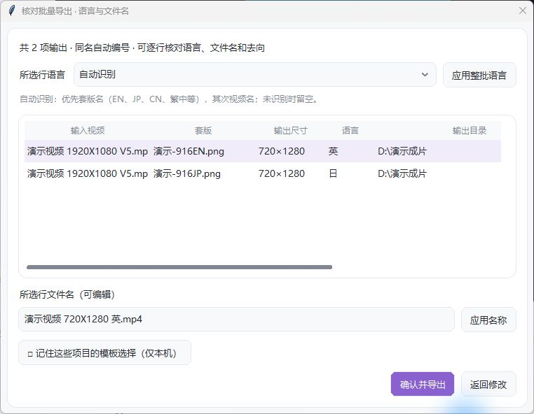

# FrameFit 本地软件图文教程

FrameFit 在 Windows 本机处理视频。桌面软件保存模板、参数、项目映射和任务；`@视频套版 FrameFit` 连接同一台电脑已打开的软件。本机视频、套版、路径和日志不上传。

> 当前为 1.6.0 源码更新；公开桌面稳定渠道尚未激活。本次源码上传不等于发布安装包，首次公开安装需等待桌面 Release。


截图为早期 1.4 界面演示，使用生成的演示视频、套版和虚构路径；部分控件名称已在 1.6 更新，以下文字以当前源码为准。

## 1. 安装与启动

完整解压 `framefit-install-<版本>-windows-x64.zip`，运行其中的 `FrameFitLauncher.exe`。保留 `versions`、`current.json` 和启动程序的目录结构。支持 Windows 10／11 64 位，包含 Python 运行依赖、FFmpeg 和 FFprobe。自行运行或打包源码见 [开发与构建说明](../plugins/framefit/README.md#从源码运行与构建)。

Codex 添加市场 `X1039538408/yuanchuan-plugins` 并安装“视频套版 FrameFit”。保持桌面软件打开，插件才能读取本机设置与任务。公开版本发布后，完整包会出现在 [GitHub Releases](https://github.com/X1039538408/yuanchuan-plugins/releases)。

## 2. 视频队列和多套版

拖入视频，或点击“添加视频”多选。队列默认显示多行，可以滚动或“展开列表”。Ctrl／Shift 多选后按 Delete 或点“移除”，只移出队列，不删除源文件。

右侧点击“管理套版”按钮打开本机总库；队列套版列也打开同一窗口。“导入套版”增加本机记录，Ctrl／Shift 单选或多选后点击“应用到当前队列”。未选择视频时只管理库。Delete 移除库记录，不删除原始图片。软件按实际选择数量处理：一张输出一份，三张各输出一份；每张独立保存窗口、适配和尺寸。

预览标题右侧可以切换当前视频的不同套版，切换预览不会减少导出数量。输出模板可保存整组套版及各自参数，下次选择并使用。

## 3. 预览、时间轴和边缘提示

拖动时间轴显示后台缓存的低清合成画面，松开后更新精确预览。未缓存位置后台读取；首次解码、长视频或网络盘仍可能等待。时间轴下方不显示缩略图。

时间轴红色为黑边、金色为白边、紫色为疑似暗缝。未拖动时悬停色段，显示时间范围、边缘位置和原片／合成来源；悬停不会跳转。点击或拖动可定位。“检查此帧”补查当前位置并标注，左侧不再单独设置边缘检查页。



原片默认每 0.5 秒抽样，检查上下左右；套版新增边缘在导出前抽查开头、中间和结尾。发现新增黑白边会要求保留，或等比例放大后复查。显示进度，可取消，也可关闭软件终止预检。抽样可能漏掉短暂变化，疑似暗缝需结合画面确认。

| 画面适配 | 效果 |
| --- | --- |
| 等比填满 | 保持比例并填满窗口，超出部分可能裁切或覆盖套版装饰 |
| 完整显示 | 保持比例，完整显示视频；比例不同时露出底层套版 |
| 拉伸铺满 | 独立拉伸宽高填满窗口，人物可能变形 |
| 自由缩放 | 以等比填满为基准，按百分比调整 |

X／Y／宽／高直接标在数值框内，拖动数字调整，单击选中后输入；支持 Shift 加速、方向键微调和 Ctrl+Z 撤回。缩放数值使用同一交互。单位是套版原图像素。视频在套版上层，放大可以覆盖装饰。

“导出尺寸与比例”支持跟随套版、16:9、9:16、1:1、4:5、3:4、4:3、2:3、3:2、21:9 和自定义偶数尺寸。画面右下角图标放大预览，再点恢复。标题、按钮、参数和下拉选项均有悬停帮助。

没有添加素材时用主题占位提示；套版画布外侧跟随界面底色，源视频本身的黑色像素保持原样。



## 4. 设置与项目匹配

左侧“设置”集中路径、关键词匹配路径开关、窗口识别类型、编码、语言、命名与分类。任务排期和本机套版根目录右侧都有“选择目录”按钮，每台电脑单独配置。



开启“关键词匹配路径”：从视频名去除尺寸和版本，查排期项目，上级目录识别公司／游戏，再定位本机输出套版。例如：

```text
视频：剧情探索 1920X1080 V3.mp4
排期：Z:\任务排期\2026\3月\工作室-示例游戏\剧情探索
套版：D:\素材\工作室\示例游戏\输出\活动套版\*.png
```

“项目匹配参考”展示匹配依据。关闭开关后按手动选择处理，不查网络排期。旧的固定游戏关键词已移除。

唯一匹配自动使用；无匹配、多个候选或路径不可用时暂停确认。候选可多选并记入本机项目映射。无匹配只预选上次套版，等待确认。同类套版同时比较文件／文件夹日期和修改时间；两者冲突时让用户选择。不同版式、尺寸和语言分别保留。已确认候选或时间戳变化时重新确认。

## 5. 命名预设和输出模板

自动语言优先读取套版名 EN／JP／CN／繁中等标记，再读视频名；均未识别则不添加。核对表可逐行或整批选择语言，语言只用于文件名，不翻译视频。

精简命名清理旧尺寸与版本，如 `v968 1920X1080 V5.mp4` → `v968 1080X1920 英.mp4`。也可选完整信息或“自定义规则”，组合以下字段并保存本机命名预设：

| 字段 | 含义 |
| --- | --- |
| `[原名]`／`[源文件名]` | 清理尺寸版本后的名字／原始文件名主体 |
| `[项目]`／`[游戏]`／`[套版]` | 对应项目、游戏、套版名 |
| `[宽]`／`[高]`／`[尺寸]`／`[比例]` | 实际输出宽高；比例为 `9-16` 等合法文件名形式 |
| `[语言]`／`[日期]` | 语言标签／本次导出日期 |
| `[序号]`／`[序号:03]`／`[扩展名]` | 序号／三位补零序号／`mp4` |

例如 `[原名]_[套版]_[尺寸]_[语言]_[序号:03]`。输入后看实时示例，点“存为预设”；选择预设恢复，删除预设不删视频。命名规则不能含路径或执行代码。

“输出模板”保存套版组合、窗口、适配、画质、命名和输出位置。项目匹配优先于共享套版组合。输出模板、预设与映射只存在本机，换电脑自行设置。

## 6. 导出与再次导出

队列单独显示“套版”列，列出当前视频选择的模板；单击该列可直接替换。选中队列行时导出所选，无选择则导出全部。已完成视频也能再次显式导出，同名自动编号；“继续未完成”恢复未完成项目。取消保留已完成结果。

导出核对表显示数量、套版、实际尺寸、语言、名称与目录，支持多行语言调整、单条改名和横纵滚动，小窗口保留底部按钮。顶部可选择已保存的导出预设和输出路径，底部输入名称即可保存当前组合。



有声保留原声，无声保持无声。自动编码优先 NVIDIA，不可用时回退 CPU；强制 GPU 失败报错。任务固定开始时的配置和版本。

## 7. Codex 调用与更新

```text
@视频套版 FrameFit 按软件上用户自定义的输出模板处理这些视频。
@视频套版 FrameFit 显示每个输出的尺寸、语言、名称和目录，先预览。
@视频套版 FrameFit 查询任务 <taskId>，完成后打开输出目录。
```

查询使用原任务编号；同一次请求重试复用 requestId，新的重复导出使用新 requestId。桌面和插件共用本机设置、输出模板与任务。

启动或点“检查更新”只读取公开清单，用户点击安装才下载、校验 SHA-256 和文件清单并重启。更新失败显示在左下角更新区域，悬停看原因并可重试，保留当前版本。未发布的本地版不会自动上传。

个人设置位于 `%LOCALAPPDATA%\FrameFit\settings.json`，任务、个人预设与日志位于 `%LOCALAPPDATA%\FrameFitCodex`，升级保留。公开包不含个人视频、模板、映射或路径。

## 8. 维护者发布与验证

用户确认后再提交 PR、合并、发布 Release。Windows x64 构建依赖见 `desktop/requirements-build.txt`，媒体工具须附来源与许可：

```powershell
python plugins/framefit/tools/build_desktop.py --version 1.6.0 --media-dir D:\media-build\bin --output dist\framefit-desktop
```

Actions **FrameFit Windows desktop release** 上传包，再创建稳定清单 PR；审核资产哈希、合并清单后其他电脑才会看到更新。插件技能和工具定义更新需刷新市场，必要时重启 Codex或新建聊天。

2026-10-16 的本机验证包括源码回归 102 项、面板契约 5 项、真实浅深色窗口与多套版预览。完整安装包和更新包通过 ZIP CRC、SHA-256 与 1343 项文件清单核对；隔离启动打包程序，通过认证接口导出英／日两种尺寸并保留音频，重复导出得到自动编号。打包 MCP Host 通过 SDK 握手、14 个工具、桌面转发和面板资源验证。

此前两份独立安装已完成本地升级包校验与设置保留模拟。实体第二台电脑、干净 Windows 镜像和公开渠道跨机更新仍属于发布验收项。本轮上传源码，不发布运行包或激活稳定清单。任务栏图标曾被反馈仍显示羽毛；目前只有图标资源和窗口设置的检查证据，任务栏目视验收仍待完成。
