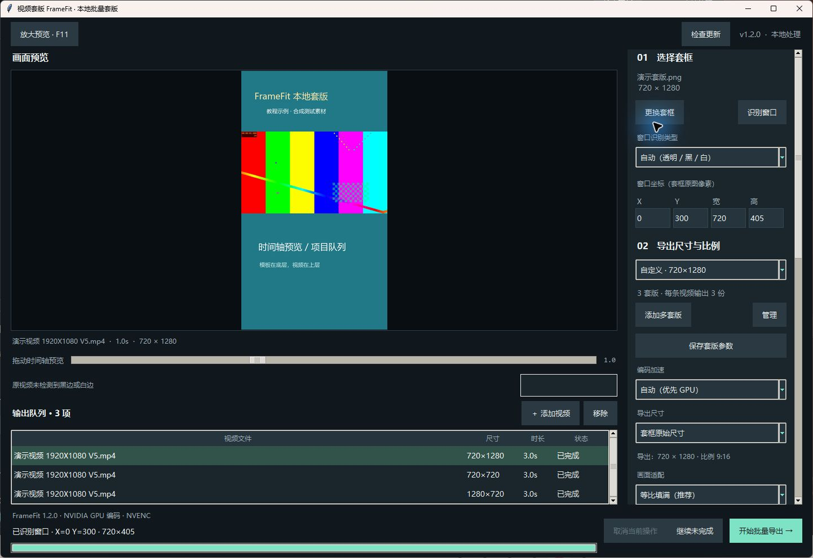
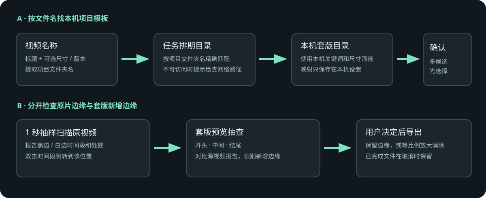
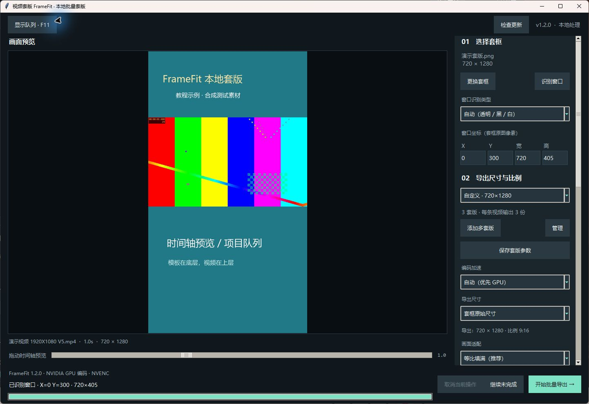
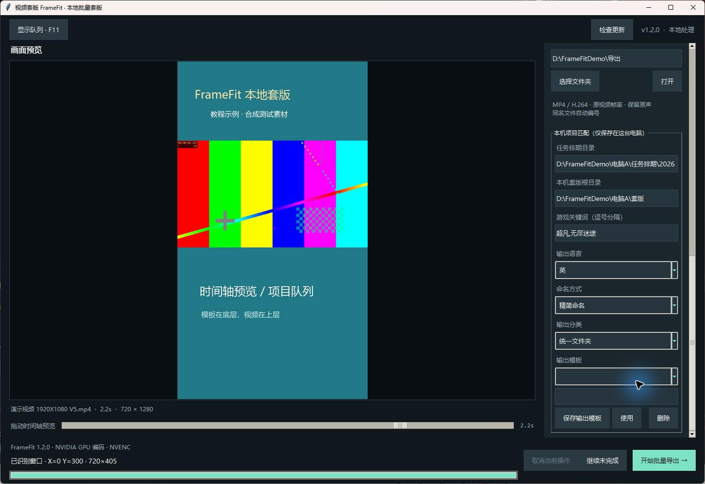

# FrameFit 本地软件使用图文教程

FrameFit 在本机完成视频处理。桌面软件保存设置并管理任务；`@视频套版 FrameFit` 通过软件提供的本地接口调用这些能力。保持软件运行，Codex 才能访问本机模板、配置和任务。



截图使用程序生成的演示视频和套版；路径为虚构示例。点击可看大图。

| 区域 | 操作位置 | 用法 |
| --- | --- | --- |
| 1 | 合成预览 | 选中视频，核对裁切、窗口和套版 |
| 2 | 时间轴 | 拖动显示缓存画面；松开后看精确合成预览 |
| 3 | 视频队列 | Ctrl／Shift 多选，Delete 移除；双击打开结果或错误 |
| 4 | 模板和窗口 | 更换模板、识别透明／黑／白窗口或填写坐标 |
| 5 | 导出设置 | 选择实际尺寸、画质与 GPU／CPU |
| 6 | 检查更新 | 启动只检查；显示新版后点击才安装 |

## 1. 安装软件并添加 Codex 插件

从 [FrameFit GitHub Releases](https://github.com/X1039538408/yuanchuan-plugins/releases) 下载最新 `framefit-install-<版本>-windows-x64.zip`，推荐将整个压缩包解压到 `%LOCALAPPDATA%\FrameFit`，运行 `FrameFit.exe`。也可放在其他本机文件夹；软件打开后，插件读取它登记的安装位置。请保留 `versions`、`FrameFit.exe` 和 `current.json` 等文件，不要只复制单独的程序文件。

在 Codex 插件市场添加 `X1039538408/yuanchuan-plugins` 并安装 **视频套版 FrameFit**。打开桌面软件后，等底部显示本机 Codex 连接就绪，再在新任务中使用 `@视频套版 FrameFit`。如果软件未启动，插件会提示先打开它。

目前 Release 工作流会在源码合并后生成安装包。运行环境为 Windows 10／11 64 位。首次安装需要公开 GitHub 下载权限；使用者不需要 GitHub 登录、Python、Node、FFmpeg 或原“批量工具”软件账号。

## 2. 加视频并预览

把视频拖到软件窗口，或点“添加视频”多选文件。左侧队列会读取每条视频的尺寸、时长和项目匹配状态。视频信息读完后即可按当前模板预览，不用等网络项目查询或边缘扫描；项目匹配完成后再更新相应模板。选中队列项后，预览区显示合成结果；拖动时间轴可以定位，松开后生成精确预览。时间轴下方不再展示缩略图；后台缓存低清帧供拖动快速显示，缓存未覆盖的位置后台读取最近一次请求，松开后恢复精确合成。长视频首次建立缓存及网络盘读取仍可能需要等待。鼠标停在右侧下拉框上滚轮只滚动设置页，点击展开后选择选项。

在队列中可用 Ctrl／Shift 多选，再按键盘 Delete 移除；也可以点“移除”。双击视频可打开素材或读取错误详情。已经完成的项目不会重复导出，取消批次时已完成的文件会保留。





## 多套版与常见输出比例

顶部方向按钮已移入右侧“导出尺寸与比例”。点击“放大预览”或按 F11 可以暂时收起下方队列，再次点击恢复。支持 16:9、9:16、1:1、4:5、3:4、4:3、2:3、3:2、21:9，或输入自定义偶数宽高。

点“添加多套版”一次选择多张套版，默认每张使用自己的原始尺寸。一个视频选择三套版，会产生三个独立输出；多个视频会按视频数×套版数生成输出项。点“管理”可编辑或移除套版；编辑后在右侧调整窗口、比例、适配，点“保存套版参数”。导出前核对每项尺寸、名称和路径。

原“本机批量配方”改名为“输出模板”，可以保存整个多套版组合、窗口、画质、命名和输出规则。已有本机配方继续读取。软件不上传这些内容。

## 3. 设置本机项目目录

右侧“本机项目匹配”设置每台电脑自己的目录。默认排期根目录是 `\\192.168.122.30\团队文件-圆串网络\任务排期\2026`，默认套版根目录是 `D:\Wu liao`，游戏关键词默认“超凡、无尽迷途”，输出目录关键词是“输出”。路径只保存在这台电脑，可按电脑、共享盘权限和年份修改。

软件会从视频名称中去掉尺寸和版本标记，再按标题查找排期项目文件夹。例如 `AE+AI-二合+剧情探索-废弃照相馆 720X1280 V3.mp4` 会把 `AE+AI-二合+剧情探索-废弃照相馆` 用于项目匹配。套版优先按软件中选定的目标方向和输出尺寸筛选；选择原始模板尺寸时，按目标方向选择模板的实际尺寸。旧文件名中的 `720×1280` 不会覆盖用户要求的转换方向，尺寸和版本也不会要求重复录入。

若项目和套版都唯一匹配，软件选择对应模板。自动匹配保留排期中的实际游戏名限定；本机目录使用不同别名时，请手动选模板并保存项目映射，共享的公司关键词不足以确认游戏。已记住的模板被修改、被删除，或目录中出现新的候选时，会重新要求确认。没有排期项目、没有套版、路径无法访问或结果重复时，队列会显示原因；多个候选可看预览后选择，并记入本机映射。没有匹配时，软件只把上次模板作为待确认选择，不会静默套用。

## 4. 检查原片和套版新增的黑白边

每条视频会在后台按约每秒抽样一次，检测原片边缘的黑边或白边。报告显示颜色、时间段和出现次数；双击时间段会跳到预览位置。抽样扫描用于快速定位，可能漏掉持续时间很短的边缘变化。

开始导出前，FrameFit 会对每个输出组合的开头、中间和结尾生成最长边约 960 像素的快速套版预览，并与原片画面对比。界面显示第几项和采样进度；点击“取消当前操作”可中止，关闭窗口时也会终止预检。已选择保留边缘的配置不会重复预检。如果套版后出现原片没有的黑边或白边，软件会暂停并列出视频与时间点。选择保留后继续，或选择放大消除；程序会等比例放大并重新检查；在允许的缩放范围内仍无法消除时，会停止并提示手动调整。

检查结果为提示而非逐帧质量证明；复杂模板、内容本身的纯黑／纯白画面也可能需要人工核对。

## 5. 调整模板、窗口和导出

在右侧“导出尺寸与比例”选择目标画布，更换模板并识别透明、黑、白区域，或手动填写 `[X,Y,宽,高]`。适配方式包括等比填满、完整显示、拉伸铺满和自由缩放；可调整分辨率、画质、GPU／CPU。模板作为底层，视频在上层，放大视频可以覆盖模板装饰。

在“输出语言”中选择自动识别、简中、英、日、韩、其他或不添加；“精简命名”会移除旧尺寸和版本标记，按实际输出尺寸生成名称，例如 `v968 1080X1920 英.mp4`。“完整信息”按原名、项目、语言和比例组合命名。选择统一输出目录，或按项目／模板分文件夹。导出前会打开核对表，逐条显示模板、实际尺寸、预期文件名和输出目录；选中一行可以修改建议文件名。



右侧设置栏可滚动。先配置本机路径，再选语言、命名和分类；在输出模板名称框输入名称并点击“保存输出模板”，下次选择输出模板后点击“使用”。导出核对表中的“记住这些项目的模板选择”只写入本机映射。

“输出模板”可以保存模板、窗口、适配、画质、命名、输出分类和目标目录。配方与项目映射不会同步到 GitHub；换电脑后需要在新电脑自行设置路径并建立本机输出模板。

## 6. 通过 Codex 调用

保持 FrameFit 打开后，可用自然语言说明素材、模板和输出要求。例如：

```text
@视频套版 FrameFit 把这些视频匹配本机项目套版，改成 9:16，文件名加“英”后缀，先检查边缘并显示文件名和导出目录。
@视频套版 FrameFit 查询任务 <taskId>，完成后打开输出目录。
@视频套版 FrameFit 把这批设置保存为“英版竖屏”；下次按该输出模板处理。
```

插件提供配置、静帧预览、缩略图、项目候选、黑白边报告、导出、任务查询、取消／继续、输出打开及本机预设和配方接口。会话和任务使用明确编号；检查进度时查询原任务，不要重复创建新任务。插件传入视频时，软件也会把素材加入桌面队列；桌面端导出显示逐条进度，Codex 和桌面导出使用同一任务记录并显示在软件队列中；可用“继续未完成”恢复原任务。语言选项用于文件命名；输出保留原声。

音频有声则保留原声，无声输入保持无声。同名文件会自动编号。自动编码优先使用 NVIDIA；不可用时回退 CPU。强制 GPU 不可用时会明确报错。

## 7. 更新与个人数据

FrameFit 启动后会读取公开稳定版本清单。发现新版时显示版本，并提供“更新到版本”按钮；只有点击按钮才下载更新。软件校验 SHA-256、版本目录和 ZIP 内文件清单，校验成功后先启动新版，确认其界面和本机接口就绪，再关闭旧版。新版启动失败会恢复旧版入口和连接。下载、校验或切换失败时保留当前可用版本。用户启动更新时若本机批次正在处理，当前批次继续用原版本，等任务完成后再重启。

本地软件文件在 `%LOCALAPPDATA%\FrameFit`；旧版“批量工具”配置迁移到同目录 `settings.json`。Codex 任务、预设和日志保存在 `%LOCALAPPDATA%\FrameFitCodex`。公开 Release 不包含个人路径、映射、视频、任务日志或自定义模板。

桌面功能更新使用 FrameFit Release，插件技能、MCP 工具接口和面板结构使用插件市场。接口更新后可刷新市场，必要时重启 Codex 并新开聊天。

## 8. 维护者发布

修改桌面功能或共享素材后，通过 PR 审核并合并。在 Windows x64 环境按 `plugins/framefit/desktop/requirements-build.txt` 安装构建依赖，并准备许可证和来源明确的 FFmpeg／FFprobe：

```powershell
python plugins/framefit/tools/build_desktop.py --version 1.2.0 --media-dir D:\media-build\bin --output dist\framefit-desktop
```

或在 GitHub Actions 运行 **FrameFit Windows desktop release**。工作流验证媒体工具下载哈希、运行自动化测试，构建安装 ZIP 与更新 ZIP，上传不可变 Release，再创建更新 `plugins/framefit/desktop/channels/stable.json` 的 PR。检查资产哈希和渠道版本后合并 PR，更新才会对其他电脑显示。维护发布说明和许可证材料见 [插件 README](../plugins/framefit/README.md) 与 [贡献指南](../CONTRIBUTING.md)。

## 9. 本次验证范围（2026-10-15）

已在当前 Windows 64 位机器验证 1.2.0 便携 GUI、一条视频三套版输出不同尺寸并保留音频、放大预览模式和缓存时间轴拖动、预检取消和检查期间退出、打包 MCP Host／Worker、真实媒体导出与原声、真实窗口中的 Delete、源码桌面与接口设置／配方／任务共用；两份独立安装已完成同一升级包的下载校验流程模拟、新版就绪确认和各自配方保留，升级后可读取新的共享预设。运行测试时 PATH 仅保留 Windows 系统目录。

两份安装的升级测试使用本地提供的校验包字节，没有把未审核版本发布为 GitHub 稳定版。实体第二台电脑、未安装过依赖的 Windows 镜像，以及刷新市场后的真实 Codex 新版工具调用，仍属于发布验收项。当前渠道标记为未发布；维护者合并源码、运行 Release 工作流并合并稳定清单 PR 后，公开更新才会生效。
