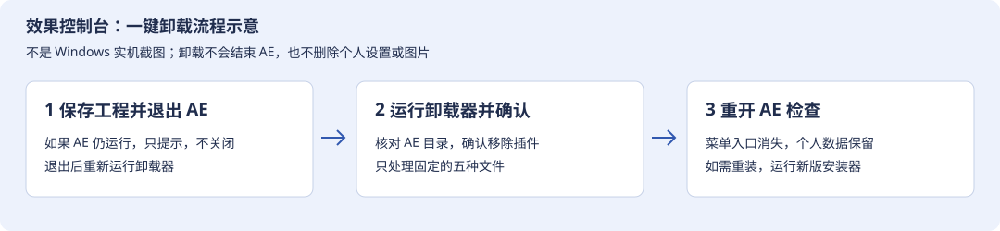

# 效果控制台 · 卸载与删除图文教程

适用 1.0.18；也可移除旧版 XFX 中文控制台的活动文件。**安装和卸载均不会结束 AE。**

[下载一键卸载器](https://github.com/X1039538408/yuanchuan-plugins/raw/refs/heads/main/other-plugins/after-effects/xfx-native-console/EffectConsoleUninstaller-1.0.18.exe) · [返回下载与使用教程](tutorial/README.md)

## 1. 保存工程，再退出 AE

先切回 AE 保存所有工程，再自行退出所有 AE。如果没有退出，卸载器会停止并提示“保存所有工程、自行退出后重试”；AE 进程继续运行，插件文件不会进入卸载事务。



*这是卸载流程示意，不是 Windows 卸载窗口实拍。*

## 2. 使用一键卸载器

1. 下载 **EffectConsoleUninstaller-1.0.18.exe**，无需解压或下载额外运行时。
2. 双击运行，在 Windows 管理员权限提示中允许执行。
3. 查看确认框内列出的 AE 目录，点击“是”继续；“否”取消。程序会处理所有检测到的有效 AE 目录。
4. 收到“卸载完成”后重开 AE，检查“窗口”菜单中“效果控制台”及旧工具栏入口已移除。再次卸载不会影响其他插件。

卸载的是以下固定清单：

| 位置（相对 AE 的 Support Files） | 处理 |
| --- | --- |
| Plug-ins/XFXNativeConsole.aex | 移除原生插件 |
| Plug-ins/XFXNativeConsole.aliases.default.tsv | 移除随包默认译名 |
| Plug-ins/XFXNativeConsole.THIRD-PARTY-NOTICES.txt | 移除随包声明 |
| Scripts/ScriptUI Panels/效果控制台.jsx | 移除新版工具栏 |
| Scripts/ScriptUI Panels/XFX 中文控制台.jsx | 若存在，移除旧版工具栏 |

**保留**用户的 aliases.tsv、aliases.user.tsv、settings.ini、旧快照、自选保存的图片、.backup-* 及 .disabled-* 备份，以及所有其他厂商插件。不会删除整个 Plug-ins、Scripts 或 AE 目录。

## 3. 自定义 AE 目录或静默卸载

在下载文件的目录打开 PowerShell，用真实 Support Files 路径替换示例：

```powershell
.\EffectConsoleUninstaller-1.0.18.exe --target 'D:\Adobe\Adobe After Effects 2026\Support Files'
```

安装器也支持 `--uninstall`。自动化场景可加 `--silent` 跳过确认和结果框；此时运行中 AE 仍会阻止操作并返回 1，原因记录在日志，不会自动关闭 AE。GUI 程序需要等待退出时用 Start-Process -Wait -PassThru。

## 4. 手动删除与可选个人数据清理

如果不使用卸载器，先保存工程并退出 AE，进入每个已安装的 Support Files，**仅删除上表中的本插件文件**。删除 AEX 即可停用原生插件；删除 JSX 移除工具栏菜单。不要删除 FX Console 或其他厂商的文件。

默认卸载保留个人数据，便于以后重装。确实不再需要时，先备份，再在资源管理器中手动检查并删除：

- AE 的 Plug-ins/XFXNativeConsole.aliases.tsv：旧版个人译名覆盖。
- 系统“文档”目录 LoYoi/XFXNative/settings.ini、aliases.user.tsv、install.log：个人设置、词库和日志。
- LoYoi/XFXNative/Capture 中的旧快照：确认不需要图片后再删除。
- 同名的 .backup-*、.disabled-* 备份：确认不需要回滚后再逐个删除。

自己选择位置保存的 PNG/JPG 由自己管理，卸载器不会搜索或删除。不要把删除整个用户“文档”目录作为清理步骤。

## 5. 失败时处理

- **AE 仍在运行：** 保存并自行退出，再重试，不需要强制关进程。
- **文件被锁定：** 本次暂存阶段会尝试恢复所有已移动文件；退出占用程序后重试。
- **目录含联接或符号链接：** 卸载器拒绝操作，请使用真实安装目录。
- **少量暂存文件删除失败：** 日志会列出 .uninstalled-* 路径；插件可能已停用，但程序返回失败。按日志检查，保留证据后再手动清理。
- **查看日志：** 系统“文档”目录 LoYoi/XFXNative/install.log，或 --log 指定的位置。

重新安装可恢复默认插件文件，个人词库和设置继续保留。构建与测试范围见 [VERIFICATION.md](VERIFICATION.md)。
