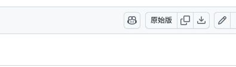
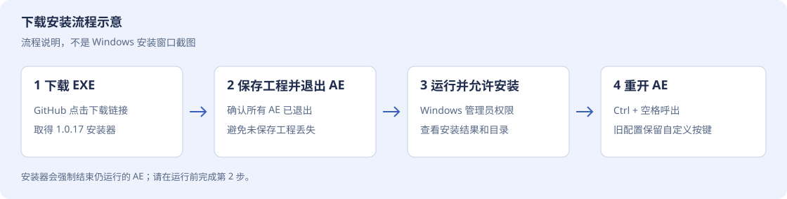
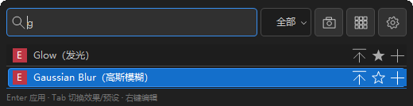
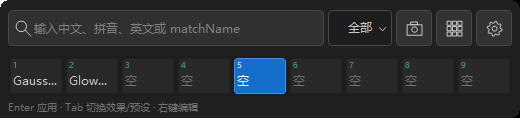
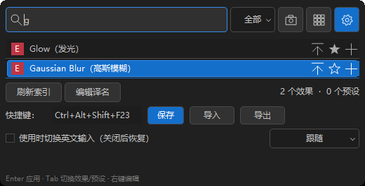
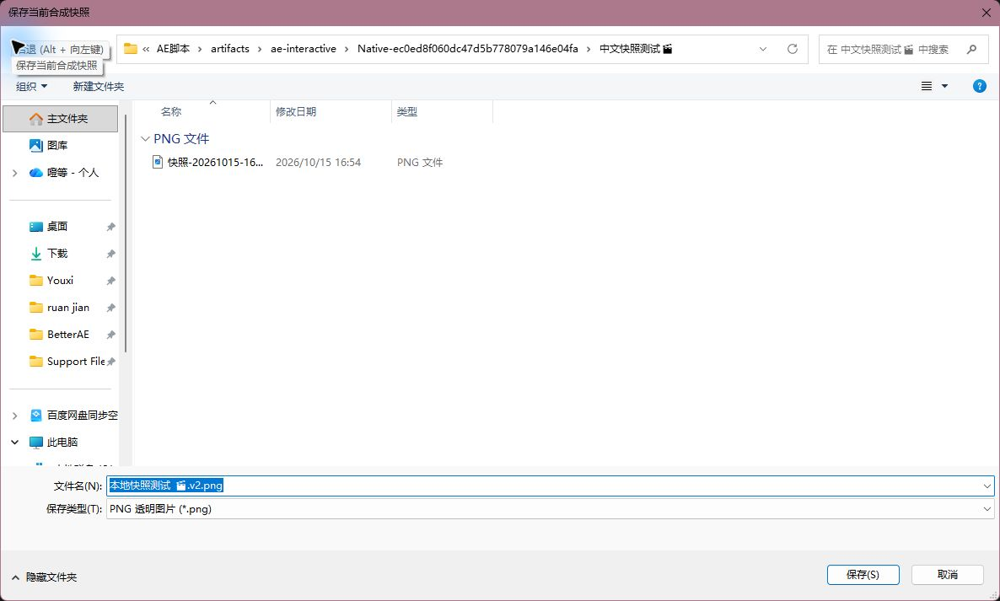

# 效果控制台 · 下载、安装与使用图文教程

适用 Windows x64 / After Effects，当前发布版本 **1.0.18 测试版**。更新日期：2026-10-19。无需 Python、Node 或 .NET。

[下载一键安装 EXE](https://github.com/X1039538408/yuanchuan-plugins/raw/refs/heads/main/other-plugins/after-effects/xfx-native-console/EffectConsoleInstaller-1.0.18.exe) · [插件发布目录](https://github.com/X1039538408/yuanchuan-plugins/tree/main/other-plugins/after-effects/xfx-native-console) · [离线网页教程](index.html)

> 安装前先保存工程并退出所有 AE。如果 AE 仍在运行，安装器会停止并提示先保存工程、自行退出后重试，不会关闭 AE。

## 1. 从 GitHub 下载

**直接下载：** 点击上方“下载一键安装 EXE”，浏览器将下载 **EffectConsoleInstaller-1.0.18.exe**（约 5 MB，无需解压）。

**从仓库查找：** 打开插件发布目录，进入 other-plugins → after-effects → xfx-native-console，点击同名 EXE 文件。在文件页右上角点击向下箭头 **Download raw file（下载原始文件）**；也可点击 **Raw / View raw（原始版 / 查看原始内容）**。



*图 1：2026-10-19 GitHub 文件页下载控件实拍。向下箭头在“原始版”和复制按钮右侧；浏览器翻译可能改变文字。页面提示无法预览二进制文件属于正常情况，使用下载按钮即可。*

下载后检查文件名以 .exe 结尾。如果取得的是网页 HTML，请返回文件页使用下载原始文件入口。无需克隆仓库、下载整个源码 ZIP 或在 Codex 市场安装。

可选校验：在 PowerShell 运行 `Get-FileHash .\EffectConsoleInstaller-1.0.18.exe -Algorithm SHA256`，应与下值一致：

```text
01DE106025E3FF74FC733910B840CE7CD7D0B4F6038807F74D6D86212E7D6384
```

## 2. 安装到 After Effects



*图 2：下载安装流程示意，不是 Windows 安装窗口截图。*

1. **保存工程并完全退出所有 AE。** 确认没有仍在运行的 After Effects。
2. 双击刚下载的 **EffectConsoleInstaller-1.0.18.exe**。
3. Windows 出现管理员权限提示时，核对是你刚启动的安装器后，选择“是”。
4. 等待安装结果，查看窗口列出的实际 AE 安装目录。安装器会自动发现有效 AE 目录并尝试安装到所有发现的版本。
5. 重新打开 AE，在“窗口”菜单查找 **效果控制台**，或按默认 **Ctrl+空格**。

**安装成功后你会得到什么？** AEX 插件、默认中文词库、第三方许可和中文 ScriptUI 工具栏。已有自定义词库、个人设置和旧版图片保留；旧安装文件保留备份。

如果没有检测到自定义目录，可在已下载 EXE 的目录打开 PowerShell，并指定 AE 的 **Support Files** 目录：

```powershell
.\EffectConsoleInstaller-1.0.18.exe --target 'D:\Adobe\Adobe After Effects 2026\Support Files'
```

上面路径只是示例，请替换为你的真实安装位置；发现 AE 目录不表示该版本已完成兼容性实测。Windows 阻止运行时，先确认来源与 SHA-256，并阅读系统给出的原因；若未获允许，安装不会完成。

## 3. 呼出控制台，添加第一个效果

1. 在 AE 中打开一个合成，并选中需要添加效果的图层。
2. 按 **Ctrl+空格**。如果已有配置保存过其他组合键，继续使用那个组合；也可从“窗口”菜单打开。
3. 输入效果名，用上下箭头或鼠标选择，按 **Enter** 或左键应用。



*图 3：已有独立 Win32 测试窗口截图，搜索内容为测试样例。展示原名（中文译名）和结果行按钮，不是本轮 AE 宿主验收截图。*

| 输入方式 | 高斯模糊示例 |
| --- | --- |
| 中文 | 高斯模糊 |
| 全拼 | gaosimohu |
| 首字母 | gsmh |
| 英文 | Gaussian Blur |

应用成功后控制台关闭，回到 AE 效果控件检查。**Ctrl+Z** 撤销；**Esc** 关闭控制台；**Tab** 切换全部、效果和预设。未知第三方效果保留原名，不翻译其参数面板。

## 4. 收藏、置顶与九个快捷槽



*图 4：独立 Win32 测试窗口截图。序号 1–9 横向排列，图中空槽和绑定内容只是示例。*

- **收藏：** 点击结果右侧星形按钮，使用筛选中的收藏入口查找。
- **置顶：** 点击置顶按钮或右键选择置顶排序；置顶顺序随设置保存。
- **绑定：** 右键结果绑定到指定槽位，或点击加号添加到下一个快捷槽。
- **执行：** 搜索为空时按 **1–9** 执行已绑定快捷项；结果列表中也可用 **Ctrl+1–9** 执行、**Ctrl+Shift+1–9** 绑定。
- **别名：** 右键“添加/编辑搜索别名”，每行输入一个名称；中文别名也支持全拼和首字母搜索。

## 5. 设置快捷键和主题



*图 5：独立 Win32 测试窗口截图。图中的 Ctrl+Alt+Shift+F23 是测试用自定义快捷键，**不是默认值**；默认值为 Ctrl+空格。*

点击齿轮展开设置。点击快捷键输入框后按新的组合键，并点击“保存”。主题选择跟随、浅色或深色。编辑用户译名后点击“刷新索引”。配置导入导出可迁移收藏、别名、快捷槽等个人设置。

再次按呼出快捷键关闭浮窗，失焦也会自动关闭。输入法选项默认关闭，启用后仅尝试切换当前输入法的中英文模式，关闭时恢复；部分第三方输入法不支持。

## 6. 保存合成当前帧

1. 激活目标合成，把时间指示器移到想要保存的帧。
2. 点击相机按钮“保存当前合成快照”。
3. 在 PNG 保存对话框中修改名称、选择位置，点击“保存”。



*图 6：已有 1.0.17 AE 宿主快照保存框实拍，路径和文件名为测试示例。历史截图不代表当前构建完成全部宿主验收。*

确认后才按完整分辨率渲染，取消不生成文件。1.0.18 已移除旧快照图库与固定截图位置；旧图片保留。

导出入口另提供透明 PNG、白底 JPG 和图片剪贴板。高位深及色彩管理项目需核对输出颜色；跨应用粘贴仍需实机验收。

## 7. 遇到问题与卸载

| 情况 | 处理方法 |
| --- | --- |
| 下载到 HTML 页面 | 返回 EXE 文件页，用 Download raw file 或本教程的直接下载链接 |
| 没有检测到 AE | 核对真实安装位置，使用 --target 指定 Support Files |
| AE 菜单中没有入口 | 完全重启 AE，检查安装成功窗口给出的目录；查看文档目录 LoYoi\XFXNative\install.log |
| 快捷键没反应 | 从窗口菜单打开，再到设置改键，避免与输入法或其他插件冲突 |
| 效果没有应用 | 检查当前合成和图层选择，查看错误提示，必要时 Ctrl+Z |
| 搜不到某个效果 | 尝试英文原名，确认 AE 已安装对应效果；编辑词库后刷新索引 |

**卸载：** 保存工程并退出 AE，在每个已安装的 Support Files 中移除 Plug-ins\XFXNativeConsole.aex 即可停用；工具栏可移除 Scripts\ScriptUI Panels\效果控制台.jsx。保留个人词库、文档目录中的 LoYoi\XFXNative 和备份。完整回滚步骤见[安装说明](https://github.com/X1039538408/yuanchuan-plugins/tree/main/other-plugins/after-effects/xfx-native-console/INSTALL.md)。

当前为测试版；物理按键、输入法组合、全部第三方效果及 ScriptUI 完整停靠仍待验收。当前版本构建与已知验收限制见[验证说明](https://github.com/X1039538408/yuanchuan-plugins/tree/main/other-plugins/after-effects/xfx-native-console/VERIFICATION.md)，不能把配图理解为全部功能验收通过。

## 8. 一键卸载与手动删除

先保存工程并自行退出 AE，下载并运行 [EffectConsoleUninstaller-1.0.18.exe](https://github.com/X1039538408/yuanchuan-plugins/raw/refs/heads/main/other-plugins/after-effects/xfx-native-console/EffectConsoleUninstaller-1.0.18.exe)，允许管理员权限，核对目标目录并确认。AE 仍运行时会提示保存退出，不会结束进程。


*流程示意，不是 Windows 卸载实拍。卸载只移除本插件活动文件，保留个人词库、设置、旧快照及备份。旧图若出现 XFX 名称，属于历史截图；当前名称为效果控制台。*

详见 [一键卸载、手动删除和个人数据清理图文教程](https://github.com/X1039538408/yuanchuan-plugins/blob/main/other-plugins/after-effects/xfx-native-console/UNINSTALL.md)。[浏览源码](https://github.com/X1039538408/yuanchuan-plugins/tree/main/other-plugins/after-effects/xfx-native-console/source) 或 [下载源码 ZIP](https://github.com/X1039538408/yuanchuan-plugins/raw/refs/heads/main/other-plugins/after-effects/xfx-native-console/EffectConsole-1.0.18-source.zip)。
