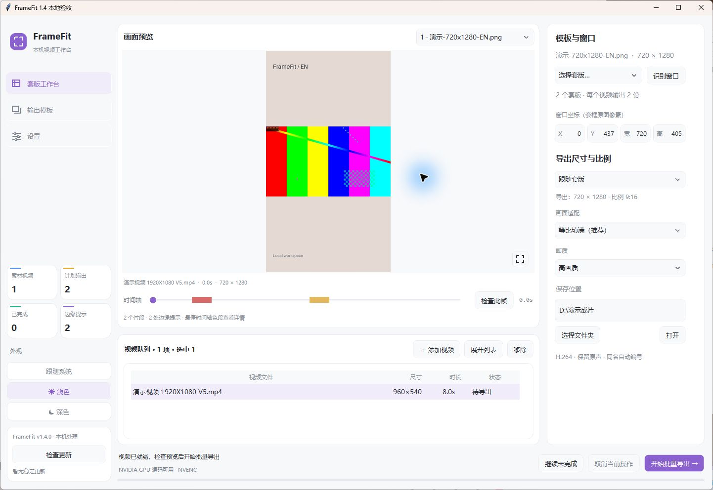

# 视频套版 FrameFit

FrameFit 现在以 Windows 64 位本地桌面软件为主要界面。本机软件保存模板、参数、项目映射与输出模板；Codex 插件通过软件启动的认证回环接口使用同一台电脑上的媒体处理能力。视频、路径、日志和个人模板不上传。

## 快速开始



当前为 1.6.0 源码更新，Windows 桌面稳定渠道尚未激活。源码上传与安装包发布是两个步骤；以下公开下载步骤在稳定版本发布后适用。

1. 从 [GitHub Releases](https://github.com/X1039538408/yuanchuan-plugins/releases) 下载 Windows x64 的 `framefit-install-<版本>-windows-x64.zip`，解压到 `%LOCALAPPDATA%\FrameFit`，运行其中的 `FrameFitLauncher.exe`。
2. 在 Codex 添加市场 `X1039538408/yuanchuan-plugins`，安装 **视频套版 FrameFit**。保持 FrameFit 桌面软件打开，再在新任务用 `@视频套版 FrameFit`。
3. 拖入视频，选择项目套版或本机模板，查看边缘检查和预期文件名后导出。

运行环境为 Windows 10／11 64 位。首次桌面安装包和 MCP 组件由 Windows Release 工作流生成；本次源码上传不激活公开桌面稳定版。桌面软件没有运行时，插件会提示启动软件。软件启动后只检查稳定版本，不会自动下载或安装；点击左栏底部的更新按钮后才会校验并切换版本。版本清单只有在对应 GitHub Release 上传后，经稳定清单 PR 审核并合并才会生效。

## 图文教程

操作步骤、项目目录设置、时间轴边缘标注、命名与更新请看 [FrameFit 图文教程](../../docs/framefit.md)。[浅色界面](docs/desktop-1.4-light.png) · [深色界面](docs/desktop-1.4-dark.jpg) · [设置](docs/settings-1.4.jpg) · [空预览](docs/empty-preview-1.4.jpg) · [导出核对](docs/export-confirm-responsive.png)

## 已接入能力

- AiMaMi 风格本机界面：侧边导航、浅色／深色／跟随系统、统一圆角卡片和控件、按钮悬停说明；预览画面保留直角，右下角图标放大预览。

- 横竖转换、自定义比例、透明／黑／白窗口识别、手动坐标、四种适配方式和自由缩放。
- 一条视频按多套版生成多种尺寸；常见比例和自定义偶数尺寸、时间轴拖动、低清画面缓存、队列 Delete 移除、模板窗口预览和批量逐条进度。
- “管理套版”按钮统一打开缩略图库，可导入、删除记录、单选／多选并应用到当前队列；点击队列套版列也使用该入口。根据已选套版数量自动导出，预览标题旁可逐套版切换。
- 按每张套版的 EN、JP、CN、繁中等标记匹配命名语言，支持逐行或整批修改；语言标签只用于文件命名。
- 设置中选择排期与套版目录，可开关关键词匹配路径；视频项目查排期，再按公司游戏找本机套版，显示匹配依据。日期与修改时间冲突时确认，不同版式和语言分别保留。
- 时间轴以红／金／紫标记黑边、白边、疑似暗缝，悬停看时间和位置；原片与合成新增边分开报告，新增边由用户选择保留或放大消除。
- 输出前显示数量、名称与目录；导出确认支持选择／保存导出预设和更换输出路径。精简／完整／自定义字段命名与本机预设、语言、分类和输出模板。选中导出所选，无选择导出全部，已完成项目可再次导出并自动编号。
- 保留音频、同名编号、GPU／CPU 编码、失败隔离、取消后保留已完成视频；桌面应用和 MCP 使用同一本机任务记录。

边缘扫描每 0.5 秒抽取一帧，分别检查上下左右黑白边，并报告疑似内部暗缝；“检查此帧”检查当前位置。时间段是抽样结果，短暂变化可能漏检，疑似暗缝需人工核对。用户项目映射、配方和路径只保存在 `%LOCALAPPDATA%\FrameFit\settings.json`；运行任务、个人预设和日志保存在 `%LOCALAPPDATA%\FrameFitCodex`。两处均不属于公开发布文件。

## 维护者发布流程

1. 通过 PR 修改 `plugins/framefit`、桌面程序、共享模板／预设和图文教程；不把本机视频、映射、个人路径、运行日志或自有模板放入 Release。
2. 合并后在 Actions 运行 **FrameFit Windows desktop release** 并填写新版本号。工作流验证固定的 FFmpeg 下载哈希，运行自动化测试，构建便携桌面程序、MCP Host、独立 Worker 和更新包。
3. 工作流上传不可变 GitHub Release，然后推送修改 `plugins/framefit/desktop/channels/stable.json` 的分支并创建稳定清单 PR。检查 Release 资产与 SHA-256 后合并该 PR，用户下次启动软件即可看到更新按钮。
4. 插件名称、技能、MCP 工具和面板结构通过插件市场更新；普通桌面功能和共享资源通过桌面更新包同步。接口变化后请刷新插件市场，必要时重启 Codex 并新开聊天。

### 从源码运行与构建

源码目录位于 [`desktop/source/`](desktop/source/)，处理引擎位于 [`server/`](server/)，MCP 配置位于 [`.mcp.json`](.mcp.json)。构建脚本为 [`tools/build_desktop.py`](tools/build_desktop.py)，媒体工具来源及校验值见 [`tools/media-dependency.json`](tools/media-dependency.json)。

在仓库根目录打开 Windows PowerShell，安装依赖并指定本机 FFmpeg／FFprobe 所在目录：

```powershell
python -m venv .venv
.\.venv\Scripts\python.exe -m pip install -r plugins/framefit/desktop/requirements-build.txt pytest
$env:FRAMEFIT_BIN_DIR = 'D:\media-build\bin'
.\.venv\Scripts\python.exe plugins/framefit/desktop/source/app.py
```

首次启动在“设置”选择这台电脑自己的任务排期和套版根目录；公开源码不携带默认个人路径。已有本机设置会继续读取，不会被升级覆盖。

构建便携包：

```powershell
.\.venv\Scripts\python.exe plugins/framefit/tools/build_desktop.py --version 1.6.0 --media-dir "$env:FRAMEFIT_BIN_DIR" --output dist\framefit-desktop
```

构建输出包括首次安装包、版本更新 ZIP 与稳定清单。解压首次安装包后使用 `FrameFitLauncher.exe`，实际界面程序为 `versions/<版本>/FrameFitApp/FrameFitStudio.exe`；保留 `FrameFit.exe` 兼容入口。第三方许可和 FFmpeg 来源说明随包放在 `licenses/`。安装端不需要额外安装 Python、Node、FFmpeg 或原软件；维护者仍需要 GitHub Release 写入权限。

### 上传范围与已知验证限制

Git 只维护源码、测试、插件定义、共享资源、教程和构建／发布脚本。个人套版库、项目映射、设置、网络路径、视频、任务记录、日志、构建环境及便携 EXE／ZIP 不提交；大型运行包单独使用 GitHub Releases。

任务栏图标仍需在发布验收中目视确认：源码包含 PNG／ICO、AppUserModelID 和 Win32 图标设置，但资源存在、窗口句柄有效或测试通过，都不能证明 Windows 任务栏已显示目标图标。之前本机反馈曾出现羽毛图标，本次不将其标记为已解决。

## 本机验证

2026-10-28 上传前在 Windows 本机设置 `FRAMEFIT_BIN_DIR` 后运行完整 Python 测试：**104 passed**；面板契约测试：**5 passed**。这覆盖源码及媒体处理自动化检查，不代替任务栏目视、干净系统或跨电脑公开更新验收。

```powershell
python -m pytest plugins/framefit/tests -q
node --test plugins/framefit/tests/panel_contract.test.mjs
```

本次已验证真实便携 GUI、打包 MCP SDK 调用、原声导出、Delete、设置／配方／任务共用，以及两份独立安装的升级包校验、新版启动确认和本机配方保留。升级使用本地校验包模拟；实体第二台电脑、干净 Windows 镜像和刷新市场后的真实 Codex 新工具调用仍需发布验收。详见图文教程的验证范围。
