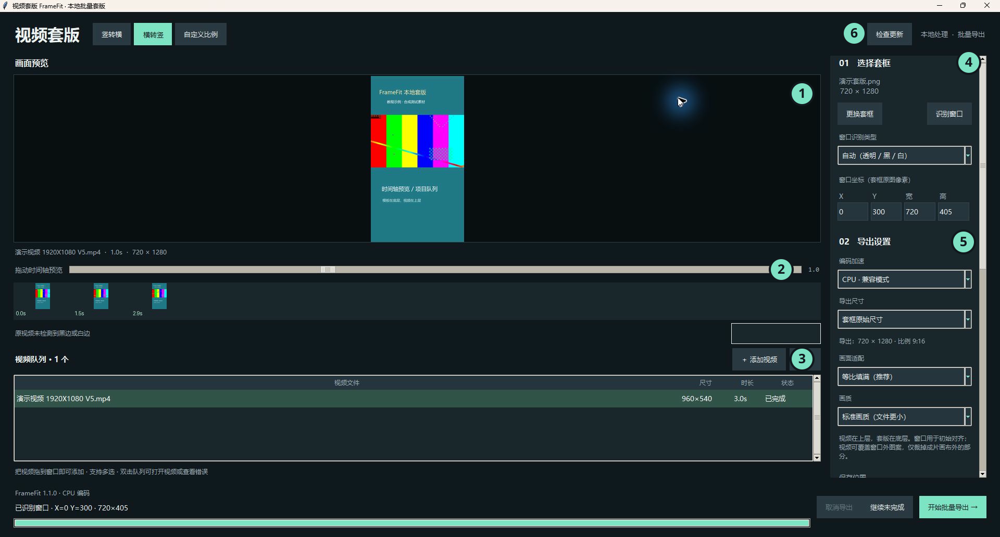

# 视频套版 FrameFit

FrameFit 现在以 Windows 64 位本地桌面软件为主要界面。本机软件保存模板、参数、项目映射与批量配方；Codex 插件通过软件启动的认证回环接口使用同一台电脑上的媒体处理能力。视频、路径、日志和个人模板不上传。

## 快速开始



1. 从 [GitHub Releases](https://github.com/X1039538408/yuanchuan-plugins/releases) 下载 Windows x64 的 `framefit-install-<版本>-windows-x64.zip`，解压到 `%LOCALAPPDATA%\FrameFit`，运行其中的 `FrameFit.exe`。
2. 在 Codex 添加市场 `X1039538408/yuanchuan-plugins`，安装 **视频套版 FrameFit**。保持 FrameFit 桌面软件打开，再在新任务用 `@视频套版 FrameFit`。
3. 拖入视频，选择项目套版或本机模板，查看边缘检查和预期文件名后导出。

运行环境为 Windows 10／11 64 位。首次桌面安装包和 MCP 组件由 Windows Release 工作流生成；本 PR 尚未激活公开桌面稳定版。桌面软件没有运行时，插件会提示启动软件。软件启动后只检查稳定版本，不会自动下载或安装；点击右上角的更新按钮后才会校验并切换版本。版本清单只有在对应 GitHub Release 上传后，经稳定清单 PR 审核并合并才会生效。

## 图文教程

操作步骤、项目目录设置、边缘检查、命名与更新请看 [FrameFit 图文教程](../../docs/framefit.md)。[真实界面标注图](docs/desktop-annotated.svg) · [本机设置截图](docs/local-settings-screenshot.png) · [项目匹配与边缘检查图](docs/project-and-borders.svg)

## 已接入能力

- 横竖转换、自定义比例、透明／黑／白窗口识别、手动坐标、四种适配方式和自由缩放。
- 时间轴拖动、开中尾缩略图、队列 Delete 移除、模板窗口预览和批量逐条进度。
- 排期路径与套版路径按电脑设置；唯一项目模板匹配后自动使用，多候选显示预览，缺失时暂停并要求确认上次模板。
- 扫描原视频黑白边的近似时间段并可跳转；将开头、中间、结尾的套版结果与原片区分，发现新增黑白边时由用户选择保留或放大消除。
- 输出前显示数量、名称与目录；语言后缀、精简／完整命名、按项目或模板分类、本机批量配方。
- 保留音频、同名编号、GPU／CPU 编码、失败隔离、取消后保留已完成视频；桌面应用和 MCP 使用同一本机任务记录。

边缘扫描每秒抽取一帧用于提示，时间段是抽样结果，最终边缘仍应通过预览核对。用户项目映射、配方和路径只保存在 `%LOCALAPPDATA%\FrameFit\settings.json`；运行任务、个人预设和日志保存在 `%LOCALAPPDATA%\FrameFitCodex`。两处均不属于公开发布文件。

## 维护者发布流程

1. 通过 PR 修改 `plugins/framefit`、桌面程序、共享模板／预设和图文教程；不把本机视频、映射、个人路径、运行日志或自有模板放入 Release。
2. 合并后在 Actions 运行 **FrameFit Windows desktop release** 并填写新版本号。工作流验证固定的 FFmpeg 下载哈希，运行自动化测试，构建便携桌面程序、MCP Host、独立 Worker 和更新包。
3. 工作流上传不可变 GitHub Release，然后推送修改 `plugins/framefit/desktop/channels/stable.json` 的分支并创建稳定清单 PR。检查 Release 资产与 SHA-256 后合并该 PR，用户下次启动软件即可看到更新按钮。
4. 插件名称、技能、MCP 工具和面板结构通过插件市场更新；普通桌面功能和共享资源通过桌面更新包同步。接口变化后请刷新插件市场，必要时重启 Codex 并新开聊天。

在 Windows x64 构建环境安装 `desktop/requirements-build.txt`，再运行：

```powershell
python plugins/framefit/tools/build_desktop.py --version 1.2.0 --media-dir D:\media-build\bin --output dist\framefit-desktop
```

构建输出包括首次安装包、版本更新 ZIP 与稳定清单。第三方许可和 FFmpeg 来源说明随包放在 `licenses/`。安装端不需要额外安装 Python、Node、FFmpeg 或原软件；维护者仍需要 GitHub Release 写入权限。

## 本机验证

```powershell
python -m pytest plugins/framefit/tests -q
node --test plugins/framefit/tests/panel_contract.test.mjs
```

本次已验证真实便携 GUI、打包 MCP SDK 调用、原声导出、Delete、设置／配方／任务共用，以及两份独立安装的升级包校验、新版启动确认和本机配方保留。升级使用本地校验包模拟；实体第二台电脑、干净 Windows 镜像和刷新市场后的真实 Codex 新工具调用仍需发布验收。详见图文教程的验证范围。
